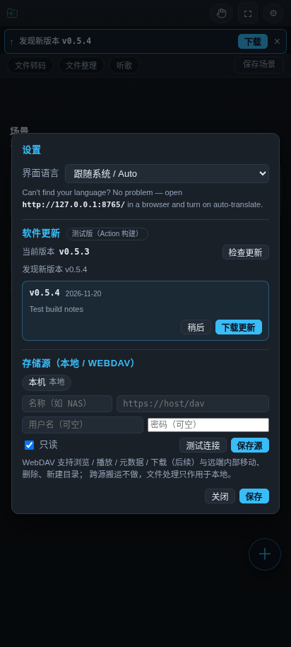

# App 更新检查回归记录（2026-11-20）

## 范围

本轮在 0.5.3 基础上新增 App 内更新检查：

- 后端 `GET /api/app_update`，支持 `force=1`、`channel=release|test`。
- 正式通道查 `releases/latest`；测试通道查 `releases/tags/debug-latest`。两个地址分别可用 `AC2_UPDATE_RELEASE_FEED`、`AC2_UPDATE_TEST_FEED` 覆盖，测试时注入本地假 feed。
- 所有网络错误、超时、GitHub 403 限流、404 和资产缺失都返回 `ok:false`，HTTP 仍为 200；自动检查失败不显示横幅，不影响启动。
- Android 侧由 `DownloadManager` 下载，只接受本仓库 `releases/download/` 的 https 地址。
- 版本号提升到 0.5.4 / versionCode 84；测试通道资产由 CI 写成 `Audio-CPM-<versionName>-<versionCode>-debug.apk`。

## 云端回归

命令：

```bash
python3 packaging/tests/cloud/run_cloud_suite.py --keep --report /tmp/ac2_final_suite.json
```

结果：

- API：48 / 48 通过
- UI：20 / 20 通过
- 合计：68 / 68 通过
- 耗时：38.04 秒
- UI console error：0，page error：0
- fixture：`/tmp/ac2_cloud_suite_yb_k8f6m`

新增覆盖：

- release 通道同版本不提示更新。
- test 通道按 `0.5.4 / 84` 的版本化 debug 资产判断更新。
- 设置卡显示当前版本、通道和“已是最新版本（0.5.3）”。
- 更新横幅渲染、关闭，以及设置浮层与横幅共存。

## 失败路径验证

使用不可达的假 feed 请求 `GET /api/app_update?force=1`，约 0.057 秒返回：

```json
{"ok": false, "error": "network", "message": "检查更新失败：..."}
```

UI 等待 7 秒：无更新横幅、无 page error，目录和其他功能不受影响。

真实 GitHub API 在当前云主机出口 IP 上被匿名限流（HTTP 403，`x-ratelimit-remaining: 0`），接口正确返回 `error=rate_limit`，没有抛出异常；因此回归使用本地假 feed，不依赖公网。

## 截图



## 构建与测试通道

- GitHub Actions run `44757459798` 成功（提交 `c299d99`），debug APK 构建和 “Publish debug build to debug-latest” 步骤均通过。
- 测试通道资产：`Audio-CPM-0.5.4-84-debug.apk`，22,574,727 字节，SHA256 `9d653d6513d0cf4e4e521b1007a1ba78b379c34007c9be3f0b0d85edf80b2cc2`。
- APK 包名 `com.github.olddriverdoge.audiocpm.dev`，versionName `0.5.4`，versionCode `84`，因此会走 test 通道。
- 用真实 Release 数据验证：release 通道选中 `Audio-CPM-0.4.33.apk`（不更新）；test 通道选中 `Audio-CPM-0.5.4-84-debug.apk`（0.5.3 更新、0.5.4 不更新）。

## 未覆盖 / 边界

- 真实 Android `DownloadManager`、通知栏、APK 手动安装、WebView JS 桥尚未真机验证。
- 截图是 Chromium 移动视口回归视图，不是 Android 真机截图。
