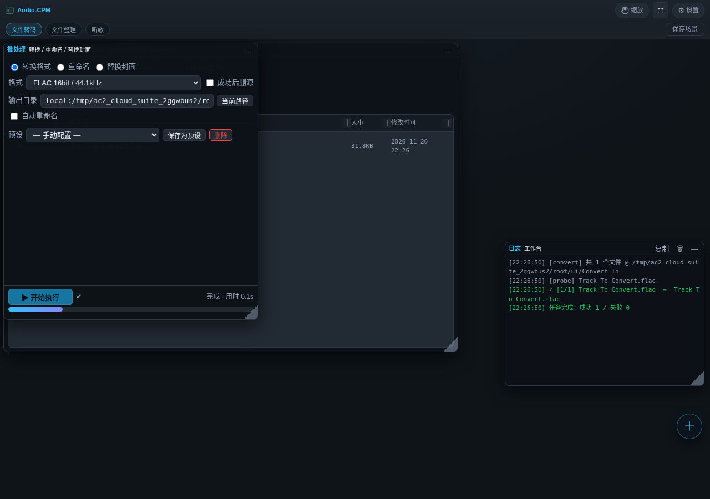
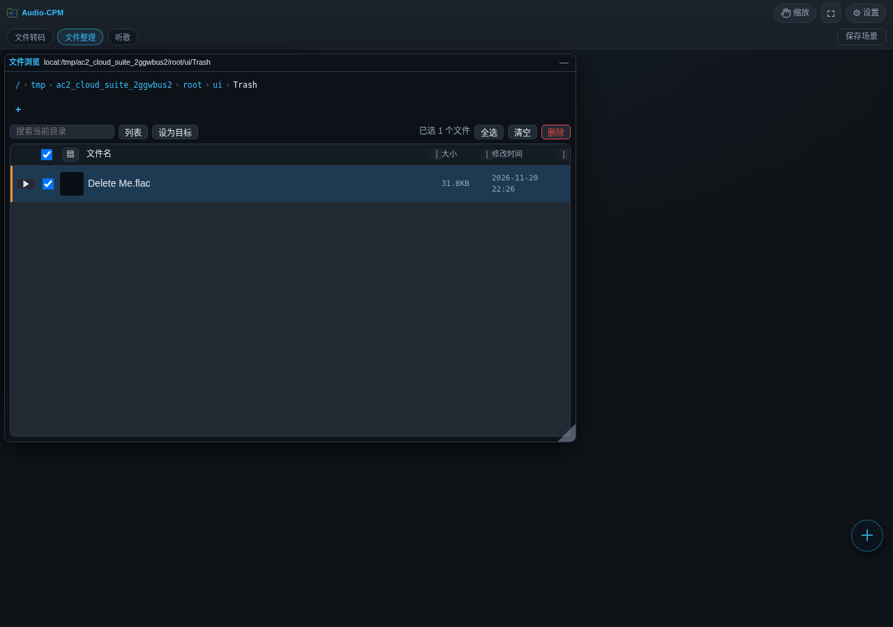
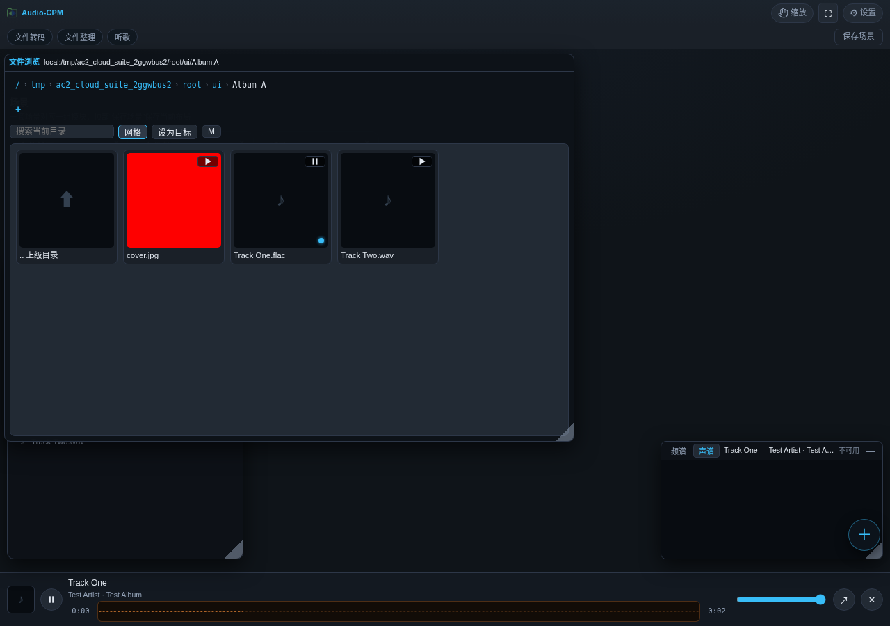
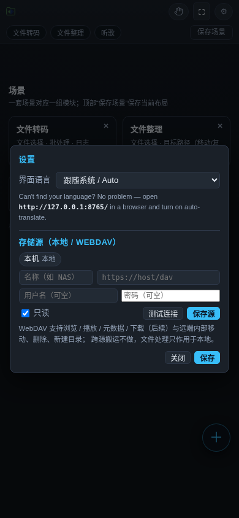

# Audio-CPM 云端全量回归测试报告

- 日期：2026-11-20
- 分支：`feat/i18n-0.4.1`
- 测试对象：仓库工作副本 `repo_check`（HEAD `6d1cbaa`，0.5.2 语言提示提交）+ 本轮 `backend/jobs_core.py` 修复
- 测试类型：真实后端 HTTP 回归 + 真实 Chromium 前端交互回归
- 结论：**通过。API 46/46，UI 18/18，合计 64/64；无页面异常、无控制台错误。完整套件约 36 秒。**



## 1. 环境

| 项目 | 值 |
|---|---|
| Python | 3.12.11 |
| Starlette | 0.46.2 |
| uvicorn | 0.40.0 |
| httpx | 0.28.1 |
| mutagen | 1.48.1 |
| Playwright | 1.64.1 |
| Chromium | 146.0.7680.31 |
| ffmpeg | 4.4.2-0ubuntu0.22.04.1 |

云端没有 Gradle/Android SDK，因此本次不构建 APK；测试直接运行 `ac_web.py` 的 Python 后端。所有测试目录由 `mkdtemp` 创建，`AC2_ROOT` 和 `AC2_DATA_DIR` 指向隔离夹具，不接触真实音乐库。

## 2. 运行命令与结果

```bash
python3 packaging/tests/cloud/run_cloud_suite.py --keep
```

```text
API: 46 passed, 0 failed
UI: 18 passed, 0 failed
REPORT FILE: /tmp/ac2_cloud_suite_2ggwbus2/report.json
RESULT: PASS
```

- 完整 JSON：`docs/testing/assets/cloud-report.json`
- 截图：`docs/testing/assets/cloud-grid.png`、`cloud-selection.png`、`cloud-convert-result.png`、`cloud-mobile.png`

## 3. API 覆盖（46 项）

所有后端路由条目均至少被命中一次，包含成功路径和错误/降级路径：

- 静态页面、`capabilities`、`roots`、存储源列表/保存/测试/删除
- `browse`、`tree`、`probe_file`、缺失目录回退、缺失文件 404
- `edit_tags`、内嵌封面探测、`image`、`thumb`、`cover`、`waveform`
- `stream` 整段响应与 HTTP Range 206
- `play` 缺失文件、非公开路径拦截
- `mkdir`/`rmdir`/`rename_dir`/`copy`/`move`/`delete`，含冲突重命名、非空目录拒绝、移入自身拒绝
- 任务：`rename-preview`、`convert`、`tags`、无 composer 的 `tags`、`check`、`cover`
- `task-presets` 保存并重新读取
- `start` 参数校验、任务列表、缺失任务状态 404、缺失任务取消 404、任务 SSE 流
- `audio/info`、`audio/devices`、`audio/device`、`audio/fx` 云端降级
- 全部 `playback/*` 路由的云端降级：open/pause/resume/stop/seek/meta/queue/volume/mode/skip/spectrum/state/diag

关键断言不是只看 HTTP 200：转换、标签、检查、封面任务都等待真实完成状态，并检查产物文件、标签或内嵌封面是否真的写入。

## 4. UI 覆盖（18 项）

- 首页 3 张内置场景卡
- 设置弹层、语言提示、切换到英文后整页重载仍显示英文提示
- 转换场景打开 browse/task/log 三个模块
- 任务类型切换、列设置面板
- 逐级浏览嵌套目录
- 点击音频行播放、网格视图和底部播放条
- 元数据浮窗、频谱浮窗
- 长按 650ms 进入选择模式、选择计数、确认删除并验证磁盘和 DOM
- 通过 UI 发起转换任务，等待真实“完成”，检查输出 FLAC 文件存在
- 音频输出面板在云端显示限制
- 保存当前布局为场景
- 390×844 移动端视口：设置弹层不溢出，语言提示正确



## 5. 本轮发现并修复的真实产品缺陷

### 5.1 替换封面任务全部失败

- 文件：`backend/jobs_core.py` → `modify_cover_v2()`
- 原因：临时文件名为 `.<原文件名>.ac2nocc` / `.ac2cc`，没有保留 `.flac` 等扩展名。ffmpeg 无法推断输出容器，报 `Unable to find a suitable output format`，封面任务每个文件都失败。
- 修复：临时文件追加源文件扩展名，例如 `.Track One.flac.ac2nocc.flac`。
- 回归证据：API `replace cover task` 通过，任务成功写入内嵌封面，`/api/cover` 返回 200。

### 5.2 无 composer 标签的普通歌曲无法自动重命名

- 文件：`backend/jobs_core.py` → `manage_single_tags_v2()`
- 原因：文件没有 composer 时直接 `raise Exception('no composer data')`，普通歌曲执行“自动重命名”会整任务失败。
- 修复：composer 为空时按 `artist` → 已有 `album_artist` → 父目录标签 → 文件名的顺序回退；已有 `album_artist` 不被覆盖。
- 回归证据：API `tags/rename tolerates missing composer` 通过，并检查新文件真实存在、名称模式已生效。

## 6. 测试脚本自身修正（非产品缺陷）

- 文件复选框默认 `opacity:0; pointer-events:none`，只有长按进入 `.sel-mode` 后才可操作；UI 测试改为真实 650ms 长按，而不是直接 `check()`。
- 转换场景中文件浏览窗会完整盖住任务窗；测试按真实用户路径，通过模块入口把任务窗提到最前再操作。
- 场景切换的语言提示会触发整页 `location.reload()`，测试改为重载后重新打开设置校验。

这些修正保证测试模拟的是用户真实操作，不是绕过 UI 的测试捷径。

## 7. 证据截图

| 截图 | 内容 |
|---|---|
| `assets/cloud-grid.png` | 网格视图 + 底部播放条 |
| `assets/cloud-selection.png` | 长按选中 1 个文件，删除按钮出现 |
| `assets/cloud-convert-result.png` | UI 转换任务真实完成，日志显示 1 个文件、成功 1、失败 0 |
| `assets/cloud-mobile.png` | 390×844 移动端设置弹层 |





## 8. 未覆盖与限制

云端测试不能替代真机验证，以下项目仍是明确空白：

- Android WebView 渲染、JS 桥、权限弹窗
- 系统文件选择器（SAF）及真实 `content://` URI
- Media3/ExoPlayer、HiFi 原生输出、USB/蓝牙音频设备
- 正式包与 `.dev` 包共用 8765 端口的冲突场景
- Android 侧 FFmpeg 8.0.1 静态二进制的实际行为；云端用系统 ffmpeg 4.4.2 验证任务命令链路
- 真机上的长按手感、滚动性能、后台切换、通知栏控制

建议下一步：安装包含本轮 `jobs_core.py` 修复的新 APK，在真机跑一遍“替换封面、无 composer 重命名、播放/频谱、目录选择、删除”五项冒烟。

## 9. 复现方式

```bash
python3 -m pip install -r packaging/tests/cloud/requirements.txt
python3 -m playwright install chromium
python3 packaging/tests/cloud/run_cloud_suite.py --keep
```

失败时查看 `--keep` 输出目录中的：

- `screenshots/`：失败步骤截图
- `server.log`：后端 stdout/stderr
- `data/ac2.log`：任务与播放日志
- `report.json`：逐项结果、控制台错误、页面错误
